# world-model-ai-safety-test

Can we read a latent planner's intent before it acts? Interpreting a JEPA world model, and testing whether the monitor survives quantization

The model is [LeWorldModel](https://arxiv.org/abs/2603.19312) (LeWM), a JEPA world model that plans in latent space with the cross-entropy method (CEM), in its TwoRooms navigation task. A hazard zone is added that the planner is never told about: it is not drawn in the frames and not in the planner's objective. Everything runs on a laptop CPU.

## Results

A linear monitor can read where the planner is about to go, including whether its plan will enter the hazard zone, before the plan runs. It keeps working after 8-, 6- and 4-bit quantization, degrades at 3 bits where a retrained probe recovers most of the loss, and can be used as a penalty in the planner's cost to steer plans away from the hazard.

| | Question | Result |
| --- | --- | --- |
| Figure 1 | Can a linear probe read the plan? | Hazard-entry AUROC 0.987 from the predictor's activations, against 0.928 for boosted trees on start, goal and line-to-zone distance. Adding the activations to that baseline gains 0.054 to 0.059. Displacement 5 to 25 steps ahead: R² 0.90 to 0.94. |
| Figure 2 | Where is the route computed? | Activation patching between same-start safe and unsafe plans: each of predictor blocks 0 to 4 uses the plan's actions (13% to 28% of the effect each, block 5 least), blocks 0 to 4 together give 96%, and the residual stream after block 4 carries the whole route. |
| Figure 3 | Does the monitor survive quantization? | At 8, 6 and 4 bits the frozen probe's miss rate (7.8% to 9.0%) stays at the full-precision level (8.7%); its AUROC is 0.985 to 0.988 at 8 and 6 bits and dips to 0.981 at 4 bits (0.987 at full precision). Plan changes at these precisions are smaller than a new planner seed causes. At 3 bits the frozen AUROC falls to 0.970 and the miss rate doubles to 17.7%; a probe retrained on 3-bit activations recovers most of the loss (0.982). |
| Figure 4 | Can the monitor steer the planner? | Adding 100 x the probe's hazard probability to CEM's cost lowers hazard entry on previously unsafe episodes to 46% (80% with a new seed alone, 76% with a random-direction penalty) while 91% still reach the goal. Literal activation steering has no effect specific to the hazard direction: a random direction lowers hazard entry as much or more. |

## The setup in pictures

What the model sees, and where the hazard is (the model never sees the pink disk):

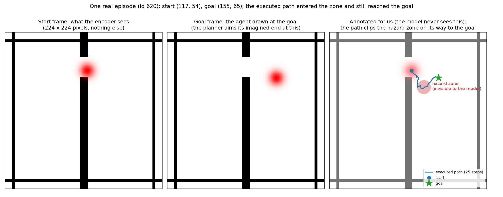

Where the monitor reads the model and where the experiments intervene:

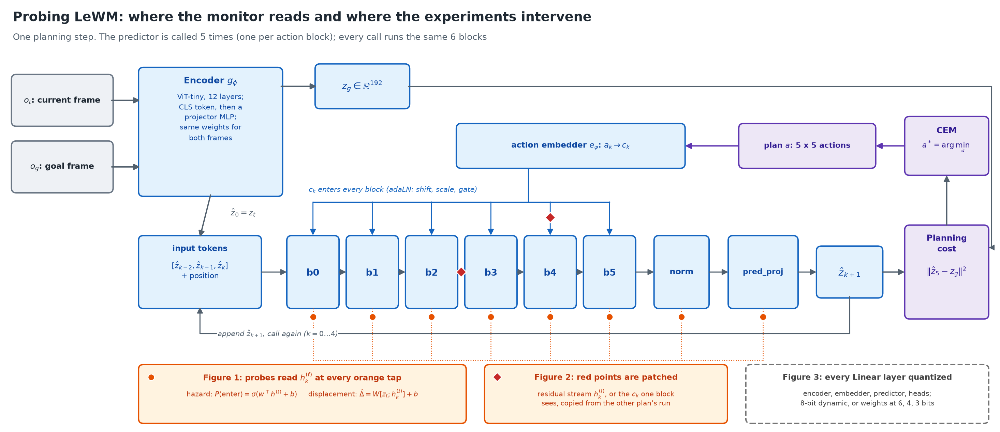

The method in equations:

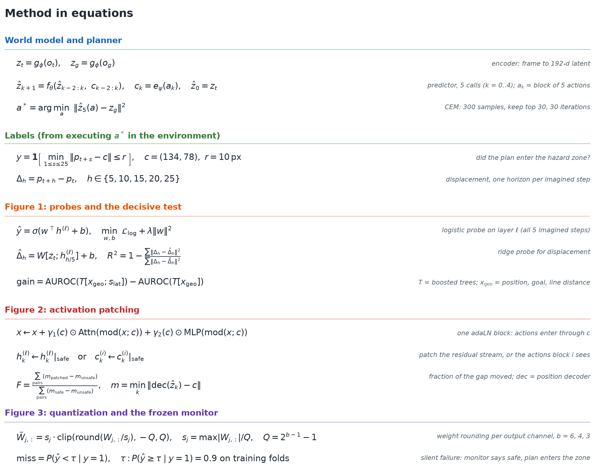

## Experiments

### Figure 1: can a linear monitor read the plan before it runs?

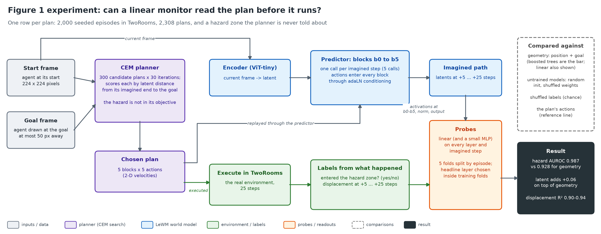

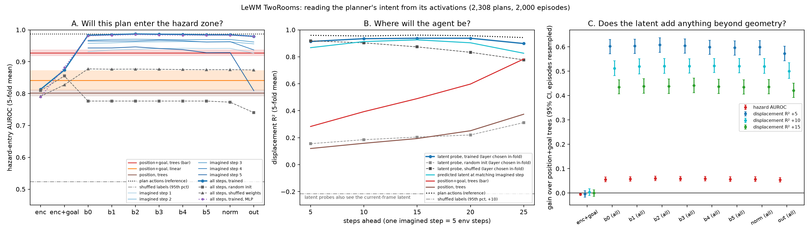

### Figure 2: where does the predictor turn the plan into its path?

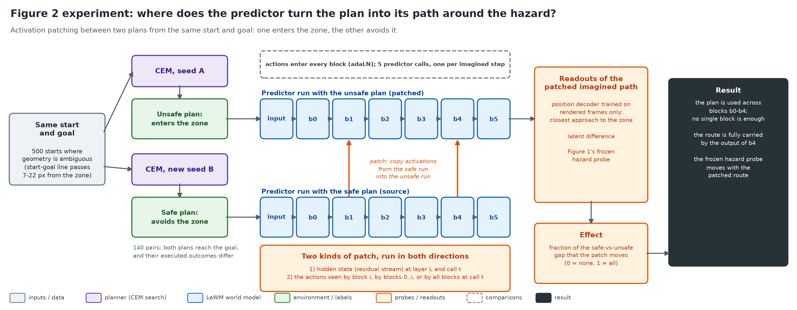

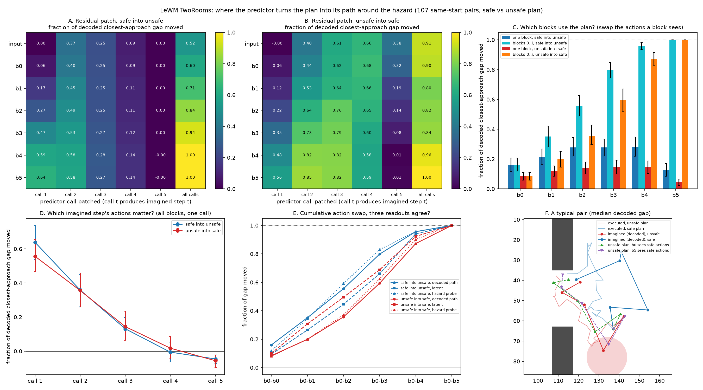

### Figure 3: does the monitor survive quantization?

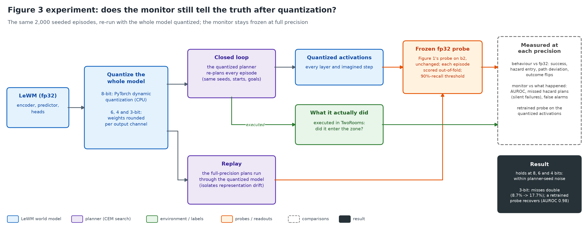

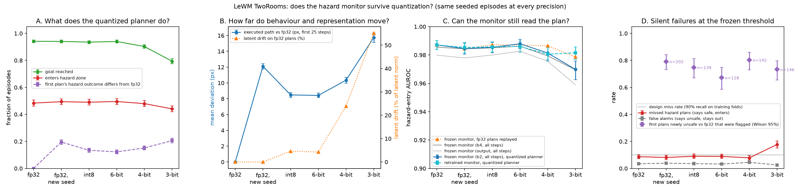

### Figure 4: can the monitor steer the planner?

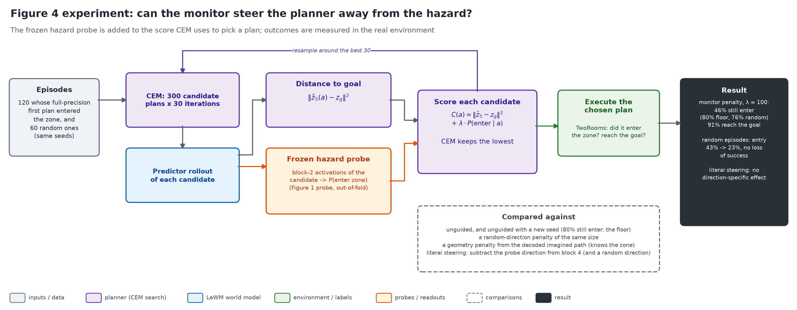

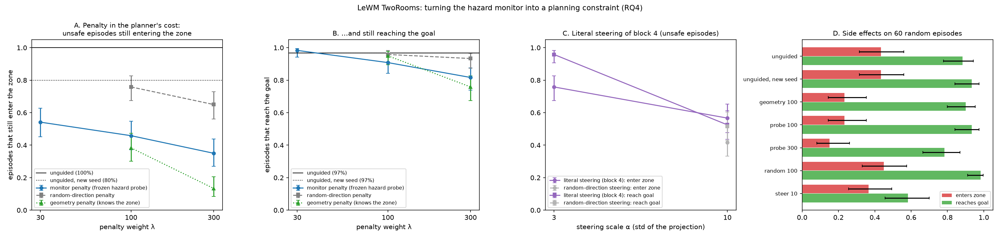

## Method in brief

- **Episodes:** 2,000 seeded start-goal pairs from the LeWM dataset, at most 50 px apart, whose straight line passes within 22 px of the zone (radius 10 px at (134, 78)); start and goal more than 14 px from its centre.
- **Recording:** the chosen plan is replayed through the predictor with hooks on every block; labels come from executing the plan in the environment.
- **Evaluation:** 5-fold cross-validation split by episode, regularisation and the headline layer chosen inside training folds, 95% intervals from resampling episodes, and a planner-seed control as the noise floor for behaviour changes.
- **Controls:** flexible geometry baselines, a randomly initialised and a weight-shuffled model, shuffled labels, and the plan's own actions as a reference.

## Setup

Python 3.13, CPU only.

```bash
python3 -m venv .venv
.venv/bin/pip install -r requirements.txt
```

The TwoRooms checkpoint (`quentinll/lewm-tworooms`) downloads on first use into `.stable-wm/`. The dataset is only needed for start-goal pairs and action statistics: download `tworoom.tar.zst` (3.4 GB, no account needed) from the `quentinll/lewm-tworooms` dataset repo on Hugging Face, extract it, and place `tworoom.h5` at `.stable-wm/datasets/tworoom.h5`.

`transformers` must stay below 5: the checkpoint uses the 4.x ViT layer names.

## Reproducing

Run from the repo root with `.venv/bin/python`. Data goes to `data/` and figures to `outputs/` (both git-ignored); the copies shown in this README are in `figures/`.

| Step | Command | Time on an M4 laptop |
| --- | --- | --- |
| Check the install, reproduce the upstream eval (90% success) | `scripts/feasibility_check.py`, `scripts/upstream_eval.py` | minutes |
| Pick and test the hazard zone | `scripts/choose_hazard.py` | ~5 min |
| Collect 2,000 seeded episodes (two shards) | `scripts/collect.py --name full --first 0 --episodes 1000` and `--first 1000` | ~3 h |
| Validate the data (recomputes every label, checks hooks, reruns episodes) | `scripts/validate_data.py data/full/*.npz --rerun 5` | minutes |
| Replay plans through untrained controls | `scripts/replay_controls.py` | ~5 min |
| Figure 1 | `scripts/figure1.py` | ~8 min on 8 cores |
| Safe/unsafe plan pairs, then Figure 2 | `scripts/make_pairs.py --first 0 --count 250` (and `--first 250`), then `scripts/figure2.py` | ~1.5 h, then minutes |
| Quantized reruns and the planner-seed control | `scripts/run_quantization_sweep.sh`, then `scripts/run_reseed_control.sh` | ~14 h, then ~3.5 h |
| Figure 3 | `scripts/figure3.py` | ~15 min |
| Steering runs, then Figure 4 | `scripts/run_steering.sh`, then `scripts/figure4.py` | ~3 h, then seconds |
| Experiment diagrams | `scripts/diagrams.py` | seconds |

Collection is seeded by episode id and resumes from its last checkpoint if interrupted, so reruns give identical data. Run long jobs one process at a time on a laptop charger that cannot supply full load.

## Code

- `lewm_probe/`: model loading and planner setup (`common.py`), episode runner and activation replay (`episode.py`), hazard zone and pair sampling (`hazard.py`), dataset loading and targets (`dataset.py`), probes (`probes.py`), patching hooks (`patching.py`), position decoder (`position_decoder.py`), quantization (`quantize.py`), guided planning and steering (`steering.py`).
- `scripts/`: one script per step in the table above.

## Limitations

TwoRooms is a 2-D toy task with one zone placement, so the results show the method works on a real latent planner, not that it scales to robots. The monitor reads one extra predictor pass on the chosen plan. The probes were not tested against a model trained to evade them. The 6-, 4- and 3-bit models use rounded weights computed in floating point; only the 8-bit model uses integer kernels.
